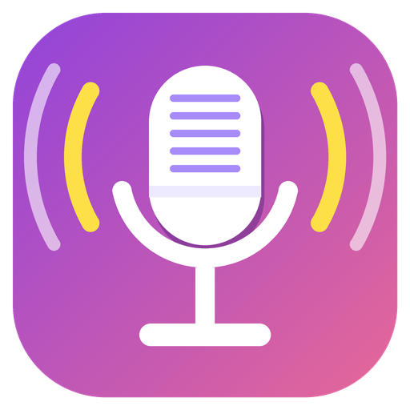
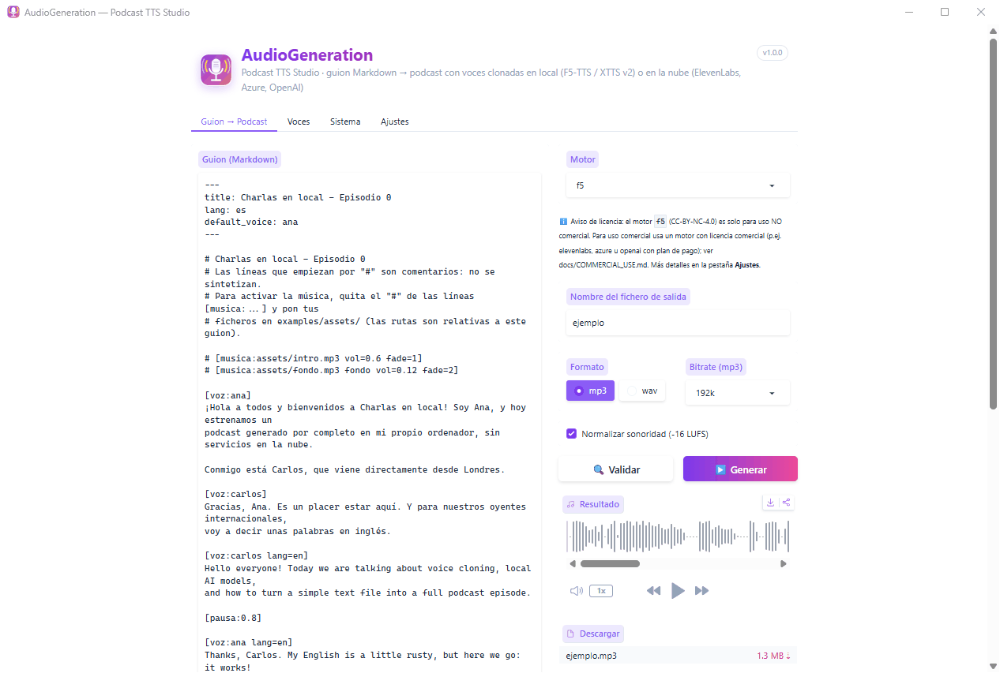

<h1 align="center">
  <br>
  AudioGeneration
</h1>

<p align="center">
  <a href="https://github.com/enriquevelmai/AudioGeneration/releases/latest"></a>
  <a href="#requisitos"></a>
  <a href="LICENSE"></a>
  <a href="MODELS_AND_LICENSES.md"></a>
  <a href="https://www.python.org/downloads/release/python-3110/"></a>
  <a href="https://github.com/enriquevelmai/AudioGeneration/actions/workflows/ci.yml"></a>
</p>

<p align="center">
  <a href="README.md">English</a> · <b>Castellano</b>
</p>

**Escribe un guion en Markdown y obtén un podcast.** AudioGeneration convierte un guion de texto
con etiquetas sencillas (`[voz:ana]`, `[pausa:1]`, `[musica:intro.mp3]`) en un MP3 terminado con
varias voces, música y efectos, clonando voces a partir de un clip de 10 segundos, todo en tu
propio PC.

<p align="center">
  
</p>

> [!IMPORTANT]
> **El código es MIT, pero los modelos de voz por defecto son de uso NO comercial.** F5-TTS /
> F5-Spanish (CC-BY-NC-4.0) y XTTS v2 (Coqui Public Model License) solo sirven para audio no
> comercial, igual que las voces de ejemplo. Para uso comercial usa un motor comercial (ElevenLabs
> con plan de pago, Azure AI Speech, OpenAI). Clona voces solo con el consentimiento de su dueño.
> Detalles en [MODELS_AND_LICENSES.md](MODELS_AND_LICENSES.md) (no es asesoramiento legal).

---

## Contenido

- [Funcionalidades](#funcionalidades)
- [Inicio rápido (para todos)](#inicio-rápido-para-todos)
- [Instalación con Git](#instalación-con-git)
- [Uso](#uso)
- [Formato del guion](#formato-del-guion)
- [Voces](#voces)
- [Motores y uso comercial](#motores-y-uso-comercial)
- [Modelos](#modelos)
- [Integración con Claude Code](#integración-con-claude-code)
- [Actualizar](#actualizar)
- [Problemas frecuentes](#problemas-frecuentes)
- [Estructura del proyecto](#estructura-del-proyecto)
- [Contribuir](#contribuir)
- [Licencia](#licencia)

---

## Funcionalidades

- **Guiones en Markdown**: un fichero `.md` por episodio, con etiquetas para hablantes, pausas,
  música y efectos. Fácil de escribir a mano, de guardar en Git o de pedir a un asistente.
- **Clonación de voz en local**: dale un clip de 5-15 s con su transcripción y la voz está lista.
  [F5-TTS](https://github.com/SWivid/F5-TTS) (por defecto; modelos nativos de inglés y castellano)
  y [XTTS v2](https://huggingface.co/coqui/XTTS-v2) (17 idiomas, 58 voces integradas) funcionan en
  tu GPU NVIDIA, o en la CPU si no tienes.
- **Motores comerciales en la nube**: ElevenLabs, Azure AI Speech y OpenAI con tu propia clave de
  API, para audio que puedes publicar con fines comerciales.
- **Varias voces y varios idiomas**: cambia de hablante, idioma, velocidad o motor en cualquier línea.
- **Acabado de estudio**: música de fondo con *ducking* automático, fundidos, efectos, pausas entre
  párrafos y normalización de sonoridad a -16 LUFS. Salida MP3 o WAV.
- **Tomas rápidas**: gracias a la caché de síntesis, al editar un guion solo se generan de nuevo
  las frases que han cambiado.
- **Tres formas de usarlo**: app de escritorio, la misma interfaz en el navegador o una línea de
  comandos completa. La interfaz y la CLI están en castellano.
- **Licencias claras**: cada motor declara su licencia, `podcast-tts engines` muestra cuáles
  permiten uso comercial y recibes un aviso cuando un guion usa uno no comercial.
- **Extensible**: añade motores como plugins sin tocar este repositorio.
- **Instalación y actualización sencillas**: un lanzador que lo instala todo la primera vez,
  modelos que se descargan solos y actualizaciones con un clic.
- **Skill opcional para Claude Code**: pide al asistente Claude Code "un podcast sobre..." y
  escribe el guion y genera el audio con este proyecto.

---

## Inicio rápido (para todos)

1. Descarga **`AudioGeneration-v1.0.0-windows.zip`** de la
   [**última release**](https://github.com/enriquevelmai/AudioGeneration/releases/latest).
2. Descomprímelo en la carpeta que quieras, por ejemplo `Documentos\AudioGeneration`. Evita
   carpetas que requieran permisos de administrador, como `Archivos de programa`.
3. Haz doble clic en **`AudioGeneration.exe`**.
4. **La primera vez** instala solo todo lo necesario: Python, las dependencias y, si tienes una GPU
   NVIDIA, PyTorch con CUDA. Tarda unos **10-15 minutos** y ocupa **unos 6-7 GB** con GPU, según tu
   conexión. También puede instalar `ffmpeg`, descargar los modelos de voz y crear accesos directos
   en el Escritorio y en el menú Inicio.
5. Se abre la app. Pulsa **Generar** con el guion de ejemplo y escucha tu primer episodio.

A partir de entonces, `AudioGeneration.exe` busca actualizaciones y abre la app en unos segundos.

> [!NOTE]
> **¿"Windows protegió su PC"?** El lanzador no está firmado digitalmente, así que Windows
> SmartScreen puede avisarte la primera vez. Pulsa **Más información → Ejecutar de todas formas**.
> Si prefieres no ejecutar el `.exe`, usa [la instalación con Git](#instalación-con-git) y los
> scripts `.bat`.

---

## Instalación con Git

```bat
git clone https://github.com/enriquevelmai/AudioGeneration.git
cd AudioGeneration
bats\install.bat
```

`bats\install.bat` no necesita permisos de administrador. Hace lo siguiente:

1. instala [uv](https://docs.astral.sh/uv/) si hace falta y Python 3.11 gestionado por uv;
2. detecta una GPU NVIDIA con `nvidia-smi` e instala PyTorch con CUDA 12.6, o la versión para CPU;
3. crea un `.venv` aislado dentro de la carpeta con exactamente las versiones de `uv.lock`;
4. comprueba `ffmpeg` y ofrece instalarlo con `winget` si falta;
5. ofrece descargar ya los modelos, crear accesos directos e instalar la skill de Claude Code.

Opciones: `/y` responde que sí a todo (sin preguntas), `/cpu` o `/cuda` fuerzan la variante de
PyTorch. También puedes generar `AudioGeneration.exe` con `bats\build_launcher.bat`.

### Requisitos

| | |
|---|---|
| **Sistema** | Windows 10 u 11 de 64 bits |
| **GPU** | Opcional. Una GPU NVIDIA con driver reciente hace la síntesis muchas veces más rápida (unas 0,2-0,3× tiempo real en una RTX 4080). Sin ella todo funciona en la CPU, mucho más despacio. Los motores en la nube no necesitan GPU |
| **Disco** | ~6-8 GB para la instalación con CUDA (menos con la variante CPU), más ~4,5 GB para los modelos, que se guardan fuera de la carpeta del proyecto |
| **ffmpeg** | Necesario para leer y escribir MP3. El instalador ofrece instalarlo |
| **Internet** | Para la primera instalación, la primera descarga de modelos, las actualizaciones y los motores en la nube |

---

## Uso

### App de escritorio

Haz doble clic en `AudioGeneration.exe`, en el acceso directo **AudioGeneration** o en
`bats\run.bat`. La interfaz se abre en su propia ventana. Si el componente de escritorio
(pywebview) no está disponible, `run.bat` la abre en el navegador.

La app tiene cuatro pestañas:

- **Guion → Podcast**: editor con el ejemplo precargado, selector de motor, formato de salida,
  **Validar** (tabla de segmentos y voces, con los errores por número de línea) y **Generar**
  (barra de progreso, log, reproductor y enlace de descarga). Los ficheros se guardan en `output/`.
- **Voces**: tus voces, su clip de referencia, **Probar voz** para oír una frase y **Añadir voz**
  para subir o grabar un clip con el micrófono, o elegir una voz integrada de XTTS.
- **Sistema**: estado de la GPU y CUDA, motores disponibles, carpetas y tamaños, caché y ficheros
  generados.
- **Ajustes**: claves de API de los motores en la nube y licencia de cada motor.

### En el navegador

`bats\run_web.bat` arranca la misma interfaz en <http://127.0.0.1:7860> y abre el navegador.

### Línea de comandos

Abre una terminal en la carpeta del proyecto y activa el entorno con `.venv\Scripts\activate`
(cmd) o `.venv\Scripts\Activate.ps1` (PowerShell), o llama directamente a
`.venv\Scripts\podcast-tts.exe`; `python -m podcast_tts` también funciona. Antes, fija dos
variables:

```powershell
$env:PYTHONUTF8 = '1'; $env:COQUI_TOS_AGREED = '1'   # cmd: set PYTHONUTF8=1 & set COQUI_TOS_AGREED=1
```

```powershell
# Generar un episodio (MP3 o WAV, según la extensión)
podcast-tts generate examples\ejemplo.md -o output\episodio.mp3

# Probar tiempos y mezcla sin modelos ni GPU (tonos en vez de voces)
podcast-tts generate examples\ejemplo.md -o output\prueba.mp3 --engine dummy

# Ver cómo se interpreta un guion (JSON), sin sintetizar
podcast-tts parse examples\english_episode.md

# Voces
podcast-tts voices list
podcast-tts voices add maria C:\grabaciones\maria.m4a --text "Transcripción exacta del clip." --lang es --engine f5
podcast-tts voices add narrador --engine xtts --xtts-speaker "Claribel Dervla" --lang en
podcast-tts voices remove maria

# Motores, licencias y claves de API
podcast-tts engines
podcast-tts config set OPENAI_API_KEY        # pide el valor sin mostrarlo
podcast-tts config show                      # valores enmascarados

# Modelos
podcast-tts models list
podcast-tts models status
podcast-tts models download all

# Interfaces
podcast-tts desktop                          # ventana de escritorio
podcast-tts ui --port 7861 --inbrowser       # navegador; --host 0.0.0.0 para tu red local, --share para un enlace público de Gradio
```

Opciones útiles de `generate`: `--engine` (fuerza un motor para todo el guion), `--voices-dir`,
`--max-chars 250`, `--bitrate 192k`, `--sample-rate 44100`, `--lufs -16`, `--no-normalize`,
`--no-cache`, `--cache-dir`, `-q`, `--no-license-notice`. Ejecuta `podcast-tts <comando> --help`
para ver la lista completa.

---

## Formato del guion

Un guion es un fichero `.md` en UTF-8. Puede empezar con un *front matter* opcional:

```markdown
---
title: Mi episodio
lang: es              # idioma por defecto
default_voice: ana    # voz para el texto anterior a la primera etiqueta [voz:]
engine: f5            # motor por defecto
paragraph_pause: 0.4  # pausa entre párrafos, en segundos
---
```

| Etiqueta | Alias | Efecto | Atributos |
|---|---|---|---|
| `[voz:nombre]` | `[voice:nombre]` | Cambia de hablante hasta la siguiente etiqueta de voz | `lang=es\|en\|...`, `speed=1.1`, `engine=f5\|xtts\|elevenlabs\|...` |
| `[pausa:1.5]` | `[pause:1.5]` | Silencio de N segundos | |
| `[musica:fichero.mp3]` | `[music:...]`, `[música:...]` | Inserta un clip musical (avanza el tiempo) | `vol=0-1` (1.0), `fade=s` (0) |
| `[musica:fichero.mp3 fondo]` | `bg`, `background` | Música de fondo bajo las voces siguientes, en bucle, con *ducking* | `vol=0-1` (0.15), `fade=s` (1.5) |
| `[musica:stop]` | `fin`, `parar` | Detiene la música de fondo con un fundido | `fade=s` (1.5) |
| `[sfx:fichero.wav]` | | Efecto superpuesto en ese punto (no avanza el tiempo) | `vol=0-1` (1.0) |
| `[titulo:...]` | `[title:...]`, `[título:...]` | Metadato, no se pronuncia | |

- Las líneas que empiezan por `#` o `<!--` son comentarios y nunca suenan.
- Una línea en blanco separa párrafos y añade una pausa corta.
- Las rutas de música y efectos son relativas al guion; las rutas con espacios van entre comillas:
  `[musica:"mis audios/intro.mp3"]`.
- Los errores indican el número de línea. Prioridad: idioma = etiqueta > front matter > voz;
  motor = `--engine` > etiqueta > front matter > voz.

Ejemplo:

```markdown
---
title: Charlas en local
lang: es
---
[musica:assets/fondo.mp3 fondo vol=0.12]
[voz:ana] Hola y bienvenidos a Charlas en local. Soy Ana.
[voz:carlos speed=0.95] Y yo, Carlos. [pausa:0.8] Hoy: podcasts a partir de texto plano.
[voz:emma lang=en] And in English, too!
[musica:stop fade=3]
```

Ejemplos listos para usar: [examples/ejemplo.md](examples/ejemplo.md) (castellano, con frases en
inglés), [examples/english_episode.md](examples/english_episode.md) (inglés) y
[guiones/ejemplo_dialogo.md](guiones/ejemplo_dialogo.md) (diálogo bilingüe). La referencia
completa, con más ejemplos, está en
[skill/podcast-tts/references/formato-guion.md](skill/podcast-tts/references/formato-guion.md).

---

## Voces

Cada voz vive en `voices/<nombre>/`: `ref.wav` (clip de referencia), `ref.txt` (su transcripción
exacta) y `voice.json` (idioma, motor, velocidad, descripción). Voces de ejemplo incluidas:

| Voz | Idioma | Motor | Descripción |
|---|---|---|---|
| `ana` | castellano | `f5` | Mujer |
| `carlos` | castellano | `f5` | Hombre |
| `emma` | inglés | `f5` | Mujer |
| `david` | inglés | `xtts` | Hombre (voz integrada de XTTS) |

> Las voces de ejemplo se generaron con voces integradas de XTTS v2 y son de uso **no comercial**.

### Añadir tu propia voz

En la app: **Voces → Añadir voz**, sube o graba un clip y escribe su transcripción. Desde la línea
de comandos:

```powershell
podcast-tts voices add maria C:\grabaciones\maria.m4a --text "Transcripción exacta, palabra por palabra, del clip." --lang es --engine f5
```

Requisitos del clip:

- **5-15 segundos** (lo ideal, 8-10 s; F5-TTS usa hasta ~12 s y XTTS hasta ~15 s).
- **Limpio**: una sola persona, sin música, sin eco ni ruido de fondo, sin cortes a mitad de palabra.
- **Transcripción exacta** (`--text` o `--text-file`): F5-TTS la necesita. Si falta, el clip se
  transcribe con Whisper (descarga adicional de ~1,6 GB y menos fiable).
- Cualquier formato que lea ffmpeg (wav, mp3, m4a...); se convierte automáticamente.
- Grabado en el idioma en que vaya a hablar la voz. F5 admite castellano e inglés; para otros
  idiomas usa `--engine xtts`.
- **Solo tu propia voz, o una voz cuyo dueño te haya dado permiso.**

XTTS v2 trae además 58 voces listas para usar, sin clip:
`podcast-tts voices add narrador --engine xtts --xtts-speaker "Marcos Rudaski" --lang es`.

Las voces en la nube apuntan a una voz del proveedor en lugar de a un clip:
`podcast-tts voices add nova --engine openai --provider-voice-id nova --lang es`
(ver [docs/COMMERCIAL_USE.md](docs/COMMERCIAL_USE.md)).

---

## Motores y uso comercial

| Motor | Dónde se ejecuta | Voces | Idiomas | Uso comercial |
|---|---|---|---|---|
| `f5` (por defecto) | Tu PC (GPU o CPU) | Clonadas de un clip | inglés, castellano | **No** (pesos CC-BY-NC-4.0) |
| `xtts` | Tu PC (GPU o CPU) | Clonadas de un clip o 58 integradas | 17 | **No** (CPML) |
| `elevenlabs` | Nube, tu clave de API | Biblioteca de voces o las tuyas | Muchos | **Solo con plan de pago** |
| `azure` | Nube, tu clave de API | Voces neuronales de Azure | Muchos | **Sí** (suscripción de Azure de pago) |
| `openai` | Nube, tu clave de API | Voces integradas de OpenAI | Muchos | **Sí** (avisa a los oyentes de que la voz es IA) |
| `dummy` | Tu PC | Tonos de prueba | | No es voz |
| plugins | Depende | Depende | Depende | Lo que declare el plugin |

Elige el motor por voz (`voice.json`), por línea (`[voz:ana engine=openai]`), por guion (`engine:`
en el front matter) o para toda la ejecución (`--engine`). `podcast-tts engines` muestra la
licencia, el uso comercial y la configuración de cada uno. Para configurar los motores en la nube
y repasar la lista de comprobación antes de publicar, lee
[docs/COMMERCIAL_USE.md](docs/COMMERCIAL_USE.md) (en inglés). Para escribir tu propio motor, lee
[docs/ENGINES_PLUGINS.md](docs/ENGINES_PLUGINS.md) (en inglés).

---

## Modelos

Los modelos **no** están en el repositorio ni en la release. Se descargan de Hugging Face la
primera vez que un motor los necesita, o antes:

```powershell
podcast-tts models download all     # f5-base, f5-spanish, vocos y xtts (~4,5 GB)
podcast-tts models status           # si están descargados, dónde y cuánto ocupan
podcast-tts models update           # última revisión de los modelos que ya tienes
```

Se guardan en las cachés estándar (`%USERPROFILE%\.cache\huggingface\hub` y `%LOCALAPPDATA%\tts`),
así que sobreviven a las reinstalaciones y se comparten con otras herramientas. La lista completa,
con repositorios, tamaños y licencias, está en [MODELS_AND_LICENSES.md](MODELS_AND_LICENSES.md).

---

## Integración con Claude Code

AudioGeneration incluye una skill opcional para
[Claude Code](https://docs.anthropic.com/en/docs/claude-code), el asistente de programación de
Anthropic. Con ella instalada, peticiones como *"haz un podcast a dos voces sobre la historia de
la radio"* o *"lee este texto con la voz de Carlos"* hacen que el asistente escriba el guion con
tus voces, lo valide y genere el MP3 con este proyecto.

- `bats\install.bat` ofrece instalarla si detecta Claude Code.
- A mano: `powershell -ExecutionPolicy Bypass -File scripts\install_skill.ps1` (crea un enlace en
  `%USERPROFILE%\.claude\skills\podcast-tts`; `-Copy` la copia en su lugar).
- La skill está en [skill/podcast-tts/](skill/podcast-tts/) y se documenta en
  [docs/SKILL.md](docs/SKILL.md).

AudioGeneration funciona perfectamente sin ella.

---

## Actualizar

- **Release (zip)**: abre `AudioGeneration.exe`. Consulta la última release de GitHub y ofrece
  actualizar.
- **Clon de Git**: `AudioGeneration.exe` lo comprueba con Git, o ejecuta `bats\update.bat`, que
  trae el código, sincroniza las dependencias con las mismas opciones con las que instalaste y
  actualiza los modelos descargados.
- **¿Has pasado de CPU a una GPU NVIDIA?** Ejecuta `bats\install_gpu.bat`.

---

## Problemas frecuentes

<details>
<summary><b>La síntesis es muy lenta / no se usa CUDA</b></summary>

Ejecuta `.venv\Scripts\python.exe scripts\check_env.py` (debe terminar en `TODO OK`) y mira la
pestaña **Sistema**. Si tienes una GPU NVIDIA pero se instaló la variante CPU (por ejemplo, porque
faltaba el driver al instalar), actualiza el driver y ejecuta `bats\install_gpu.bat`.
`PODCAST_TTS_DEVICE=cpu` o `cuda` fuerza el dispositivo. La primera generación siempre es más
lenta porque se cargan los modelos.
</details>

<details>
<summary><b>GPU de la serie RTX 50 (Blackwell)</b></summary>

La versión de PyTorch incluida usa CUDA 12.6, que no admite las RTX 50 (sm_120). Necesitan la
versión con CUDA 12.8 (`cu128`): cambia el índice `pytorch-cu126` de `pyproject.toml` a
`https://download.pytorch.org/whl/cu128`, ejecuta `uv lock --python 3.11` y reinstala. Mientras
tanto, `bats\install.bat /cpu` funciona, más despacio. Ver [docs/ENGINES.md](docs/ENGINES.md).
</details>

<details>
<summary><b>"ffmpeg no encontrado" o errores con MP3</b></summary>

Instálalo con `winget install --id Gyan.FFmpeg -e` (o desde <https://www.gyan.dev/ffmpeg/builds/>)
y abre una terminal nueva para que se actualice el `PATH`. La salida WAV funciona sin ffmpeg.
</details>

<details>
<summary><b>SmartScreen bloquea AudioGeneration.exe</b></summary>

El lanzador no está firmado digitalmente. Pulsa **Más información → Ejecutar de todas formas**, o
usa `bats\run.bat` desde una [instalación con Git](#instalación-con-git).
</details>

<details>
<summary><b>No se abre la ventana de escritorio (WebView2)</b></summary>

La app de escritorio usa Microsoft Edge WebView2, que viene instalado en Windows 11 y en la
mayoría de equipos con Windows 10. Si falta, instala el
[WebView2 Runtime](https://developer.microsoft.com/microsoft-edge/webview2/) o usa
`bats\run_web.bat` para abrir la interfaz en el navegador.
</details>

<details>
<summary><b>Memoria de GPU insuficiente</b></summary>

Cierra otros programas que usen la GPU (incluida una segunda copia de la app) y vuelve a
intentarlo. F5-TTS y XTTS v2 juntos necesitan unos 5 GB de VRAM.
</details>

<details>
<summary><b>XTTS se cuelga al cargar, o <code>UnicodeEncodeError</code> en la consola</b></summary>

Define `COQUI_TOS_AGREED=1` y `PYTHONUTF8=1` antes de ejecutar la CLI. Los scripts `.bat`, el
lanzador y la skill ya lo hacen.
</details>

<details>
<summary><b>La voz suena mal o pronuncia mal algunas palabras</b></summary>

Usa un clip más limpio de 8-10 s y comprueba que `ref.txt` coincide palabra por palabra. Asegúrate
de que el idioma de la voz coincide con el del texto (`lang=`). Para idiomas distintos del
castellano y el inglés usa `xtts`.
</details>

<details>
<summary><b>Un motor en la nube devuelve 401, 403 o 429</b></summary>

401: clave incorrecta (`podcast-tts config set ...`). 402/403: tu plan no lo permite. 404: voz,
modelo o región incorrectos. 429: límite de peticiones o de cuota. Ver
[docs/COMMERCIAL_USE.md](docs/COMMERCIAL_USE.md#errors).
</details>

---

## Estructura del proyecto

```
AudioGeneration/
├── AudioGeneration.exe        # lanzador (en el zip de la release; se genera con bats\build_launcher.bat)
├── assets/icon.png            # icono de la aplicación
├── bats/                      # install, run, run_web, update, install_gpu, create_shortcuts, build_launcher
├── src/podcast_tts/
│   ├── script_parser.py       # guion Markdown -> segmentos
│   ├── assembler.py           # síntesis, mezcla, normalización, exportación, caché
│   ├── voices.py              # registro de voces (voices/)
│   ├── models.py              # catálogo, estado y descarga de modelos
│   ├── config.py              # claves de API (.env)
│   ├── licensing.py           # avisos de licencia
│   ├── cli.py                 # línea de comandos podcast-tts
│   ├── ui.py                  # interfaz Gradio
│   └── engines/               # f5, xtts, elevenlabs, azure, openai, dummy + registro de plugins
├── voices/                    # voces de ejemplo: ana, carlos, emma, david
├── examples/, guiones/        # guiones de ejemplo (guiones/ es también donde la app guarda los tuyos)
├── skill/podcast-tts/         # skill opcional de Claude Code
├── scripts/                   # check_env.py, install_skill.ps1, make_sample_voices.py, pruebas smoke
├── docs/                      # documentación (índice: docs/README.md)
├── tests/                     # pytest
├── output/                    # audio generado (ignorado por Git)
└── .cache/tts/                # caché de síntesis (ignorada por Git)
```

---

## Contribuir

Las contribuciones son bienvenidas. Lee [CONTRIBUTING.md](CONTRIBUTING.md) (en inglés) para el
entorno de desarrollo con uv, los tests, la guía de estilo y cómo añadir un motor. Los cambios se
recogen en [CHANGELOG.md](CHANGELOG.md) y toda la documentación está indexada en
[docs/README.md](docs/README.md).

---

## Licencia

El **código fuente** se publica bajo la [licencia MIT](LICENSE). © 2026 enriquevelmai.

La licencia MIT **no** se aplica a los pesos de los modelos que descarga el programa, al audio que
generan, a las voces de ejemplo ni a los servicios en la nube. Todos ellos conservan sus propias
licencias y términos, y **los modelos locales por defecto son de uso no comercial**. Ver
[MODELS_AND_LICENSES.md](MODELS_AND_LICENSES.md) y [docs/COMMERCIAL_USE.md](docs/COMMERCIAL_USE.md).
Eres responsable de cumplirlos y de tener el consentimiento de cualquier voz que clones.
