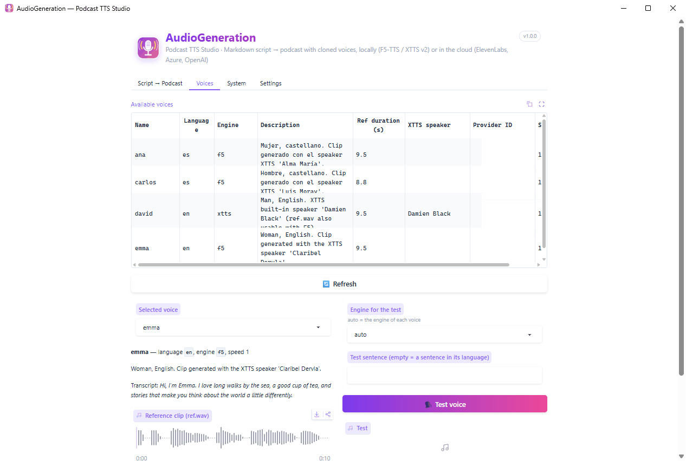
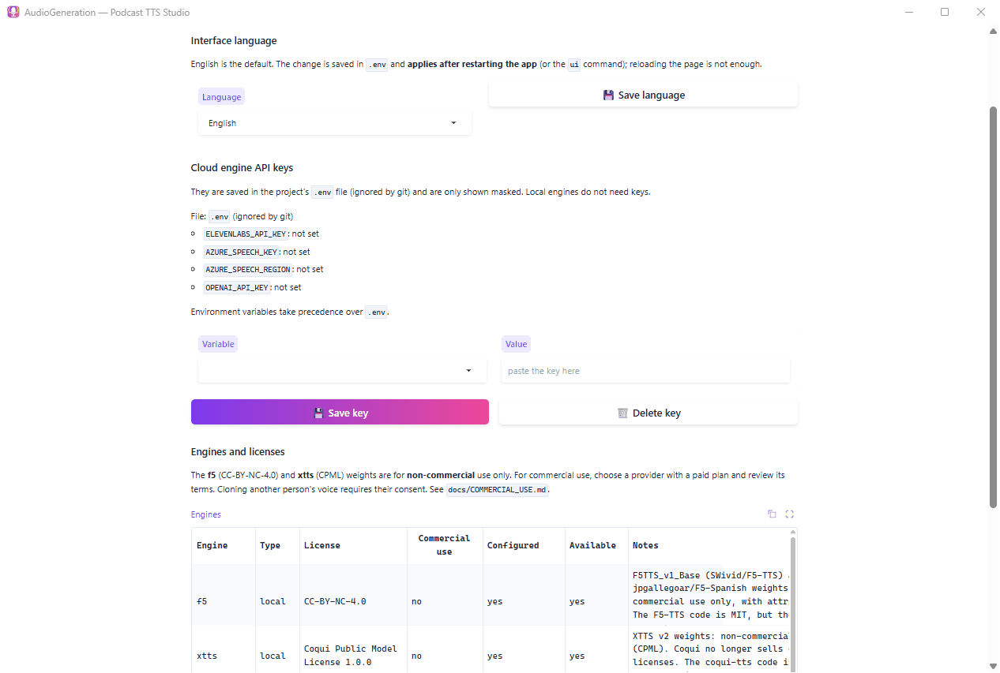
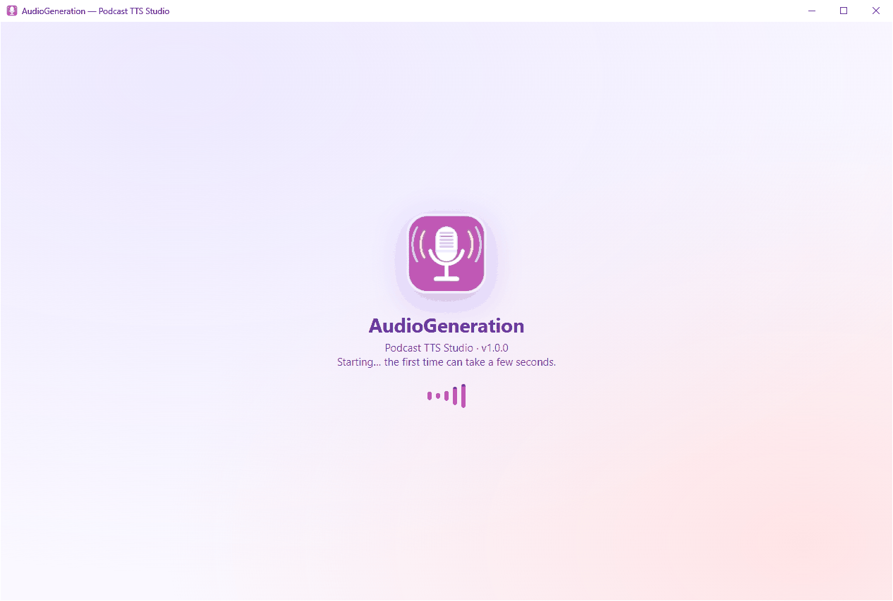

<h1 align="center">
  <br>
  AudioGeneration
</h1>

<p align="center">
  <a href="https://github.com/enriquevelmai/AudioGeneration/releases/latest"></a>
  <a href="#requirements"></a>
  <a href="LICENSE"></a>
  <a href="MODELS_AND_LICENSES.md"></a>
  <a href="https://www.python.org/downloads/release/python-3110/"></a>
  <a href="https://github.com/enriquevelmai/AudioGeneration/actions/workflows/ci.yml"></a>
</p>

<p align="center">
  <b>English</b> · <a href="README.es.md">Castellano</a>
</p>

**Write a script in Markdown, get a podcast.** AudioGeneration turns a plain text script with
simple tags (`[voice:emma]`, `[pause:1]`, `[music:intro.mp3]`) into a finished MP3 with several
voices, music and sound effects, cloning voices from a 10-second clip, entirely on your own PC.

<p align="center">
  
</p>

<table align="center">
  <tr>
    <td align="center"><br><sub>Voices</sub></td>
    <td align="center"><br><sub>Settings: engines and licenses</sub></td>
    <td align="center"><br><sub>Desktop app starting</sub></td>
  </tr>
</table>

> [!IMPORTANT]
> **The code is MIT, but the default voice models are non-commercial.** F5-TTS / F5-Spanish
> (CC-BY-NC-4.0) and XTTS v2 (Coqui Public Model License) can only be used for non-commercial
> audio, and so can the sample voices. For commercial work use a commercial engine (ElevenLabs on a
> paid plan, Azure AI Speech, OpenAI). Only clone voices with their owner's consent. Details in
> [MODELS_AND_LICENSES.md](MODELS_AND_LICENSES.md) (not legal advice).

---

## Contents

- [Features](#features)
- [Quick start (for everyone)](#quick-start-for-everyone)
- [Install with Git](#install-with-git)
- [Usage](#usage)
- [Script format](#script-format)
- [Voices](#voices)
- [Engines and commercial use](#engines-and-commercial-use)
- [Models](#models)
- [Claude Code integration](#claude-code-integration)
- [Use it from AI assistants (MCP)](#use-it-from-ai-assistants-mcp)
- [Updating](#updating)
- [Troubleshooting](#troubleshooting)
- [Project structure](#project-structure)
- [Contributing](#contributing)
- [License](#license)

---

## Features

- **Markdown scripts**: one `.md` file per episode, with tags for speakers, pauses, music and
  sound effects. Easy to write by hand, to keep in Git, or to have an assistant draft for you.
- **Local voice cloning**: give it a 5-15 s clip and its transcript and the voice is ready.
  [F5-TTS](https://github.com/SWivid/F5-TTS) (default; native English and Spanish models) and
  [XTTS v2](https://huggingface.co/coqui/XTTS-v2) (17 languages, 58 built-in speakers) run on your
  NVIDIA GPU, or on the CPU if you have none.
- **Commercial cloud engines**: ElevenLabs, Azure AI Speech and OpenAI with your own API key, for
  audio you can publish commercially.
- **Multi-voice and multilingual**: switch speaker, language, speed or engine on any line.
- **Studio finish**: background music with automatic ducking, fades, sound effects, paragraph
  pauses and loudness normalization to -16 LUFS. MP3 or WAV output.
- **Fast re-takes**: a synthesis cache means that after editing a script only the changed
  sentences are generated again.
- **Three ways to use it**: a desktop app, the same interface in your browser, or a full command
  line. The interface and the CLI are in English by default, with Spanish available.
- **Honest about licenses**: every engine declares its license, `podcast-tts engines` shows
  which ones allow commercial use, and you get a notice when a script uses a non-commercial one.
- **Extensible**: add engines as plugins without touching this repository.
- **Easy install and updates**: a launcher that installs everything on first run, models that
  download themselves, and one-click updates.
- **Optional Claude Code skill**: ask the Claude Code assistant for "a podcast about..." and it
  writes the script and generates the audio with this project.

---

## Quick start (for everyone)

1. Download **`AudioGeneration-v1.0.0-windows.zip`** from the
   [**latest release**](https://github.com/enriquevelmai/AudioGeneration/releases/latest).
2. Extract it (right-click → **Extract All**) into a folder of your choice, for example
   `Documents`. The zip contains an `AudioGeneration` folder with everything inside. Avoid folders
   that need administrator rights, such as `Program Files`, and very long paths.
3. Open the `AudioGeneration` folder and double-click **`AudioGeneration.exe`**.
4. **The first time** it installs everything it needs by itself: Python, the dependencies and, if
   you have an NVIDIA GPU, PyTorch with CUDA. It takes about **10-15 minutes** and **about 6-7 GB** with a
   GPU, depending on your connection. It can also install `ffmpeg`, download the voice models and
   create Desktop and Start menu shortcuts.
5. The app opens. Click **Generate** on the example script and listen to your first episode.

From then on, `AudioGeneration.exe` checks for updates and opens the app in a few seconds.

> [!NOTE]
> **"Windows protected your PC"?** The launcher is not code-signed, so Windows SmartScreen may warn
> you the first time. Click **More info → Run anyway**. If you prefer not to run the `.exe`, use
> [the Git installation](#install-with-git) and the `.bat` scripts instead.

---

## Install with Git

```bat
git clone https://github.com/enriquevelmai/AudioGeneration.git
cd AudioGeneration
bats\install.bat
```

`bats\install.bat` needs no administrator rights. It:

1. installs [uv](https://docs.astral.sh/uv/) if needed and Python 3.11 managed by uv;
2. detects an NVIDIA GPU with `nvidia-smi` and installs PyTorch with CUDA 12.6, or the CPU build;
3. creates an isolated `.venv` inside the folder with exactly the versions in `uv.lock`;
4. checks `ffmpeg` and offers to install it with `winget` if it is missing;
5. offers to download the models now, create shortcuts, and install the Claude Code skill.

Options: `/y` answers yes to everything, shortcuts included (unattended), `/noshortcuts` skips the
shortcuts, `/cpu` or `/cuda` force the PyTorch build and `/dev` adds the development tools
(pytest). You can also build `AudioGeneration.exe` yourself with `bats\build_launcher.bat`.

### Requirements

| | |
|---|---|
| **OS** | Windows 10 or 11, 64-bit |
| **GPU** | Optional. An NVIDIA GPU with a recent driver makes synthesis many times faster (about 0.2-0.3× real time on an RTX 4080). Without one, everything runs on the CPU, much more slowly. Cloud engines need no GPU |
| **Disk** | ~6-8 GB for the installation with CUDA (less with the CPU build), plus ~4.5 GB for the models, which are stored outside the project folder |
| **ffmpeg** | Needed to read and write MP3. The installer offers to install it |
| **Internet** | For the first installation, the first model download, updates and the cloud engines |

---

## Usage

### Desktop app

Double-click `AudioGeneration.exe`, the **AudioGeneration** shortcut, or `bats\run.bat`. The
interface opens in its own window. If the desktop component (pywebview) is not available,
`run.bat` opens it in your browser instead.

The app has four tabs:

- **Script → Podcast**: script editor with the example preloaded, engine selector, output format,
  **Validate** (table of segments and voices, with errors by line number) and **Generate** (progress
  bar, log, player and download link). Files are saved in `output/`.
- **Voices**: your voices, their reference clip, **Test voice** to hear a sentence, and
  **Add voice** to upload or record a clip with the microphone, or pick a built-in XTTS speaker.
- **System**: GPU and CUDA status, available engines, folders and sizes, cache and generated files.
- **Settings**: API keys for the cloud engines, the interface language and the license of every
  engine.

### In the browser

`bats\run_web.bat` starts the same interface at <http://127.0.0.1:7860> and opens your browser.

### Command line

Open a terminal in the project folder and activate the environment with `.venv\Scripts\activate`
(cmd) or `.venv\Scripts\Activate.ps1` (PowerShell), or call `.venv\Scripts\podcast-tts.exe`
directly; `python -m podcast_tts` works too. Set two variables first:

```powershell
$env:PYTHONUTF8 = '1'; $env:COQUI_TOS_AGREED = '1'   # cmd: set PYTHONUTF8=1 & set COQUI_TOS_AGREED=1
```

```powershell
# Generate an episode (MP3 or WAV, by extension)
podcast-tts generate examples\english_episode.md -o output\episode.mp3

# Check timing and mixing without models or GPU (tones instead of voices)
podcast-tts generate examples\english_episode.md -o output\test.mp3 --engine dummy

# See how a script is interpreted (JSON), without synthesizing
podcast-tts parse examples\english_episode.md

# Voices
podcast-tts voices list
podcast-tts voices add maria C:\recordings\maria.m4a --text "Exact transcript of the clip." --lang es --engine f5
podcast-tts voices add narrator --engine xtts --xtts-speaker "Claribel Dervla" --lang en
podcast-tts voices remove maria

# Engines, licenses and API keys
podcast-tts engines
podcast-tts config set OPENAI_API_KEY        # asks for the value without echoing it
podcast-tts config show                      # masked values

# Models
podcast-tts models list
podcast-tts models status
podcast-tts models download all

# Interfaces
podcast-tts desktop                          # desktop window
podcast-tts ui --port 7861 --inbrowser       # browser, only on this PC (127.0.0.1)
podcast-tts ui --host 0.0.0.0 --auth ana:a-long-password   # your LAN, with user and password
```

> [!WARNING]
> The UI has no accounts: whoever can open it can generate audio, delete voices and use your
> API keys. With `--host` other than `127.0.0.1`/`localhost`, or with `--share` (a public
> Gradio link), it refuses to start unless you set `--auth user:password` (or the
> `PODCAST_TTS_AUTH` variable), and it runs in *remote mode*: no **Settings** tab (API keys) and
> music/sfx only from relative paths. Only expose it on networks you trust.

Useful `generate` options: `--engine` (force one engine for the whole script), `--voices-dir`,
`--max-chars 250`, `--bitrate 192k`, `--sample-rate 44100`, `--lufs -16`, `--no-normalize`,
`--no-cache`, `--cache-dir`, `-q`, `--no-license-notice`. Run `podcast-tts <command> --help` for
the full list.

### Language

The interface and the CLI messages are in English by default. To use them in Spanish, set the
`PODCAST_TTS_LANG` environment variable before starting the app or the CLI:

```powershell
$env:PODCAST_TTS_LANG = 'es'   # cmd: set PODCAST_TTS_LANG=es
```

or choose it in the app under **Settings → Language**. This only changes the UI and CLI messages:
scripts can be written in any language either way, and the script tags work the same.

---

## Script format

A script is a UTF-8 `.md` file. It can start with an optional front matter:

```markdown
---
title: My episode
lang: en              # default language
default_voice: emma   # voice for text before the first [voice:] tag
engine: f5            # default engine
paragraph_pause: 0.4  # pause between paragraphs, in seconds
---
```

| Tag | Aliases | Effect | Attributes |
|---|---|---|---|
| `[voice:name]` | `[voz:name]` | Switches speaker until the next voice tag | `lang=es\|en\|...`, `speed=1.1`, `engine=f5\|xtts\|elevenlabs\|...` |
| `[pause:1.5]` | `[pausa:1.5]` | Silence of N seconds | |
| `[music:file.mp3]` | `[musica:...]`, `[música:...]` | Plays a music clip (time advances) | `vol=0-1` (1.0), `fade=s` (0) |
| `[music:file.mp3 bg]` | `background`, `fondo` | Background music under the following voices, looped, with ducking | `vol=0-1` (0.15), `fade=s` (1.5) |
| `[music:stop]` | `fin`, `parar` | Stops the background music with a fade | `fade=s` (1.5) |
| `[sfx:file.wav]` | | Sound effect overlaid at that point (time does not advance) | `vol=0-1` (1.0) |
| `[title:...]` | `[titulo:...]`, `[título:...]` | Metadata, not spoken | |

- Lines starting with `#` and `<!-- ... -->` blocks (also multi-line) are comments and are never
  spoken. Brackets that are not a `[type:...]` tag, such as `- [ ]` checkboxes, are plain text,
  and Markdown links `[text](url)` are read as "text".
- A blank line separates paragraphs and adds a short pause.
- Music and effect paths are relative to the script; quote paths with spaces:
  `[music:"my audio/intro.mp3"]`.
- The Spanish tags in the Aliases column are accepted too, so older scripts keep working.
- Errors point to the line number. Priority: language = tag > front matter > voice; engine =
  `--engine` > tag > front matter > voice.

Example:

```markdown
---
title: Local Voices
lang: en
---
[music:assets/background.mp3 bg vol=0.12]
[voice:emma] Hello and welcome to Local Voices. I'm Emma.
[voice:david speed=0.95] And I'm David. [pause:0.8] Today: podcasts from plain text.
[voice:ana lang=es] ¡Y también en castellano!
[music:stop fade=3]
```

Ready-to-run examples: [examples/english_episode.md](examples/english_episode.md) (English),
[examples/ejemplo.md](examples/ejemplo.md) (Spanish, with English lines) and
[examples/ejemplo_dialogo.md](examples/ejemplo_dialogo.md) (bilingual dialogue). The scripts you
save from the app go to `guiones/`, which git ignores. The full reference, with more examples, is
in [skill/podcast-tts/references/script-format.md](skill/podcast-tts/references/script-format.md).

---

## Voices

Each voice lives in `voices/<name>/`: `ref.wav` (reference clip), `ref.txt` (its exact transcript)
and `voice.json` (language, engine, speed, description). Included sample voices:

| Voice | Language | Engine | Description |
|---|---|---|---|
| `ana` | Spanish | `f5` | Female |
| `carlos` | Spanish | `f5` | Male |
| `emma` | English | `f5` | Female |
| `david` | English | `xtts` | Male (built-in XTTS speaker) |

> The sample voices were generated with built-in XTTS v2 speakers and are **non-commercial**.

### Add your own voice

In the app: **Voices → Add voice**, upload or record a clip and type its transcript. From the
command line:

```powershell
podcast-tts voices add maria C:\recordings\maria.m4a --text "Exact, word-for-word transcript of the clip." --lang es --engine f5
```

Clip requirements:

- **5-15 seconds** (8-10 s is ideal; F5-TTS uses up to ~12 s, XTTS up to ~15 s).
- **Clean**: one person, no music, no echo or background noise, not cut mid-word.
- **Exact transcript** (`--text` or `--text-file`): F5-TTS needs it. Without it, the clip is
  transcribed with Whisper (an extra ~1.6 GB download, and less reliable).
- Any format ffmpeg can read (wav, mp3, m4a...); it is converted automatically.
- Recorded in the language the voice will speak. F5 supports Spanish and English; for other
  languages use `--engine xtts`.
- **Only your own voice, or a voice whose owner has given you permission.**

XTTS v2 also brings 58 ready-made speakers, no clip needed:
`podcast-tts voices add narrator --engine xtts --xtts-speaker "Marcos Rudaski" --lang es`.

Cloud voices point to a voice of the provider instead of a clip:
`podcast-tts voices add nova --engine openai --provider-voice-id nova --lang es`
(see [docs/COMMERCIAL_USE.md](docs/COMMERCIAL_USE.md)).

---

## Engines and commercial use

| Engine | Where it runs | Voices | Languages | Commercial use |
|---|---|---|---|---|
| `f5` (default) | Your PC (GPU or CPU) | Cloned from a clip | English, Spanish | **No** (CC-BY-NC-4.0 weights) |
| `xtts` | Your PC (GPU or CPU) | Cloned from a clip or 58 built-in | 17 | **No** (CPML) |
| `elevenlabs` | Cloud, your API key | Voice library or your own | Many | **Paid plans only** |
| `azure` | Cloud, your API key | Azure neural voices | Many | **Yes** (paid Azure subscription) |
| `openai` | Cloud, your API key | Built-in OpenAI voices | Many | **Yes** (disclose AI voices to listeners) |
| `dummy` | Your PC | Test tones | | Not speech |
| plugins | Depends | Depends | Depends | As declared by the plugin |

Choose the engine per voice (`voice.json`), per line (`[voice:ana engine=openai]`), per script
(front matter `engine:`) or for the whole run (`--engine`). `podcast-tts engines` shows the
license, commercial-use status and configuration of each one. To set up the cloud engines and for
a checklist before publishing, read [docs/COMMERCIAL_USE.md](docs/COMMERCIAL_USE.md). To write your
own engine, read [docs/ENGINES_PLUGINS.md](docs/ENGINES_PLUGINS.md).

---

## Models

Models are **not** included in the repository or the release. They are downloaded from Hugging
Face the first time an engine needs them, or in advance:

```powershell
podcast-tts models download all     # f5-base, f5-spanish, vocos and xtts (~4.5 GB)
podcast-tts models status           # downloaded?, where, and size
podcast-tts models update           # latest revision of the models you already have
```

They are stored in the standard caches (`%USERPROFILE%\.cache\huggingface\hub` and
`%LOCALAPPDATA%\tts`), so they survive reinstalls and are shared with other tools. The full list,
with repositories, sizes and licenses, is in [MODELS_AND_LICENSES.md](MODELS_AND_LICENSES.md).

---

## Claude Code integration

AudioGeneration includes an optional skill for [Claude Code](https://docs.anthropic.com/en/docs/claude-code),
Anthropic's coding assistant. With it installed, requests like *"make a two-voice podcast about
the history of radio"* or *"read this text aloud with Carlos's voice"* make the assistant write
the script with your existing voices, validate it and generate the MP3 with this project.

- `bats\install.bat` offers to install it when Claude Code is present.
- Manually: `powershell -ExecutionPolicy Bypass -File scripts\install_skill.ps1` (creates a link
  in `%USERPROFILE%\.claude\skills\podcast-tts`; `-Copy` copies it instead).
- The skill is in [skill/podcast-tts/](skill/podcast-tts/) and is documented in
  [docs/SKILL.md](docs/SKILL.md).

AudioGeneration works fully without it.

---

## Use it from AI assistants (MCP)

AudioGeneration includes an [MCP](https://modelcontextprotocol.io) server, so you can ask **any
MCP-compatible assistant** (Claude Desktop, Claude Code, Cursor, VS Code, Windsurf...) *"make me a
podcast about X"* and it will write the script, validate it and generate the complete MP3 on your
computer, with your voices. The server exposes tools such as `list_voices`, `get_script_format`,
`validate_script`, `generate_podcast`, `synthesize_text` and `add_voice`, plus a `podcast` prompt.

**Install** (after `bats\install.bat`):

```bat
bats\install_integrations.bat
```

It installs the `mcp` extra if needed, then detects and asks:

- **Claude Code**: installs the skill and runs `claude mcp add --scope user podcast-tts ...`.
- **Claude Desktop**: adds `podcast-tts` to `%APPDATA%\Claude\claude_desktop_config.json`, keeping
  your other servers and saving a `.bak` copy first. Restart Claude Desktop afterwards.
- **Other clients**: prints the JSON to paste.

Options: `/y` (no questions), `/claude-code`, `/claude-desktop`, `/print`, `--uninstall`. It can be
run again at any time.

**Manual configuration** for Cursor (`~/.cursor/mcp.json`), Claude Desktop and most clients
(`bats\install_integrations.bat /print` prints it with your real paths; VS Code uses `"servers"`
with `"type": "stdio"`):

```json
{
  "mcpServers": {
    "podcast-tts": {
      "command": "C:\\path\\to\\AudioGeneration\\.venv\\Scripts\\python.exe",
      "args": ["-m", "podcast_tts", "mcp"],
      "env": {
        "PYTHONPATH": "C:\\path\\to\\AudioGeneration\\src",
        "PYTHONUTF8": "1",
        "COQUI_TOS_AGREED": "1"
      }
    }
  }
}
```

**Example:**

> **You:** Make me a 3-minute podcast about the history of coffee, with Emma and David.
>
> **Assistant:** *(lists the voices, reads the script format, writes a ~450-word dialogue,
> validates it and generates it)* Done: `C:\...\AudioGeneration\output\history_of_coffee.mp3`
> (3:04, generated in 1 min 25 s). Note: F5-TTS is for non-commercial use. Want me to change the
> tone, the length or the voices?

Files are saved to `output/` (or `PODCAST_TTS_OUTPUT_DIR`). Long episodes do not hit client
timeouts: the tool returns a job id after 45 s and the assistant polls `get_generation_status`.
Full tool reference: [docs/MCP.md](docs/MCP.md).

---

## Updating

- **Release (zip)**: just open `AudioGeneration.exe`. It checks the latest GitHub release and,
  if there is a newer one, offers to open its download page; extract the new zip and run
  `bats\install.bat` again.
- **Git clone**: `AudioGeneration.exe` checks with Git, or run `bats\update.bat`, which pulls the
  code, syncs the dependencies with the same options you installed and updates the downloaded
  models.
- **Switched from CPU to an NVIDIA GPU?** Run `bats\install_gpu.bat`.

---

## Troubleshooting

<details>
<summary><b>Nothing happens, or "No module named podcast_tts"</b></summary>

Install AudioGeneration in a **short path** without unusual characters, for example
`C:\AudioGeneration` or `Documents\AudioGeneration`: very long paths break some dependencies
(numba reports "filename too long"). Folders with accents or `ñ` are supported since this version;
if you installed an older one there, run `bats\install.bat` again. If the app closes right after
opening, `AudioGeneration.exe` shows the end of the log; `launcher.log` (next to the exe) and
`%LOCALAPPDATA%\AudioGeneration\desktop.log` have the details.
</details>

<details>
<summary><b>Synthesis is very slow / CUDA is not used</b></summary>

Run `.venv\Scripts\python.exe scripts\check_env.py` (it should end with `ALL OK`) and check the
**System** tab. If you have an NVIDIA GPU but the CPU build was installed (for example, the driver
was missing during installation), update the driver and run `bats\install_gpu.bat`.
`PODCAST_TTS_DEVICE=cpu` or `cuda` forces the device. The first generation is always slower
because the models are loaded.
</details>

<details>
<summary><b>RTX 50 series (Blackwell) GPUs</b></summary>

The bundled PyTorch build uses CUDA 12.6, which does not support RTX 50 GPUs (sm_120). They need the
CUDA 12.8 build (`cu128`): change the `pytorch-cu126` index in `pyproject.toml` to
`https://download.pytorch.org/whl/cu128`, run `uv lock --python 3.11` and reinstall. Meanwhile,
`bats\install.bat /cpu` works, more slowly. See [docs/ENGINES.md](docs/ENGINES.md).
</details>

<details>
<summary><b>"ffmpeg not found" or MP3 errors</b></summary>

Install it with `winget install --id Gyan.FFmpeg -e` (or from <https://www.gyan.dev/ffmpeg/builds/>)
and open a new terminal so the `PATH` is updated. WAV output works without ffmpeg.
</details>

<details>
<summary><b>SmartScreen blocks AudioGeneration.exe</b></summary>

The launcher is not code-signed. Click **More info → Run anyway**, or use `bats\run.bat` from a
[Git installation](#install-with-git).
</details>

<details>
<summary><b>The desktop window does not open (WebView2)</b></summary>

The desktop app uses Microsoft Edge WebView2, which is preinstalled on Windows 11 and most
Windows 10 PCs. If it is missing, install the
[WebView2 Runtime](https://developer.microsoft.com/microsoft-edge/webview2/) or use
`bats\run_web.bat` to open the interface in your browser.
</details>

<details>
<summary><b>Out of GPU memory</b></summary>

Close other programs using the GPU (including a second copy of the app) and try again. F5-TTS and
XTTS v2 together need about 5 GB of VRAM.
</details>

<details>
<summary><b>XTTS hangs on load, or <code>UnicodeEncodeError</code> in the console</b></summary>

Set `COQUI_TOS_AGREED=1` and `PYTHONUTF8=1` before running the CLI. The `.bat` scripts, the
launcher and the skill already do it.
</details>

<details>
<summary><b>The voice sounds wrong or mispronounces words</b></summary>

Use a cleaner 8-10 s clip and check that `ref.txt` matches it word for word. Make sure the voice's
language matches the text (`lang=`). For languages other than Spanish and English use `xtts`.
</details>

<details>
<summary><b>A cloud engine returns 401, 403 or 429</b></summary>

401: wrong key (`podcast-tts config set ...`). 402/403: your plan does not allow it. 404: wrong
voice, model or region. 429: rate limit or quota. See [docs/COMMERCIAL_USE.md](docs/COMMERCIAL_USE.md#errors).
</details>

---

## Project structure

```
AudioGeneration/
├── AudioGeneration.exe        # launcher (in the release zip; build it with bats\build_launcher.bat)
├── assets/icon.png            # application icon
├── bats/                      # install, run, run_web, update, install_gpu, create_shortcuts, build_launcher
├── src/podcast_tts/
│   ├── script_parser.py       # Markdown script -> segments
│   ├── assembler.py           # synthesis, mixing, normalization, export, cache
│   ├── voices.py              # voice registry (voices/)
│   ├── models.py              # model catalog, status and download
│   ├── config.py              # API keys (.env)
│   ├── licensing.py           # license notices
│   ├── cli.py                 # podcast-tts command line
│   ├── ui.py                  # Gradio interface
│   └── engines/               # f5, xtts, elevenlabs, azure, openai, dummy + plugin registry
├── voices/                    # sample voices: ana, carlos, emma, david
├── examples/                  # example scripts
├── guiones/                   # your scripts saved from the app (ignored by git)
├── skill/podcast-tts/         # optional Claude Code skill
├── scripts/                   # check_env.py, install_skill.ps1, make_sample_voices.py, smoke tests
├── docs/                      # documentation (index: docs/README.md)
├── tests/                     # pytest
├── output/                    # generated audio (ignored by Git)
└── .cache/tts/                # synthesis cache (ignored by Git)
```

---

## Contributing

Contributions are welcome. Read [CONTRIBUTING.md](CONTRIBUTING.md) for the development setup with
uv, the tests, the style guide and how to add an engine. Changes are listed in
[CHANGELOG.md](CHANGELOG.md) and all documentation is indexed in [docs/README.md](docs/README.md).

---

## License

The **source code** is released under the [MIT License](LICENSE). © 2026 enriquevelmai.

The MIT license does **not** apply to the model weights the program downloads, to the audio they
produce, to the sample voices or to the cloud services. Those keep their own licenses and terms,
and **the default local models are non-commercial**. See
[MODELS_AND_LICENSES.md](MODELS_AND_LICENSES.md) and [docs/COMMERCIAL_USE.md](docs/COMMERCIAL_USE.md).
You are responsible for complying with them and for having consent for any voice you clone.
